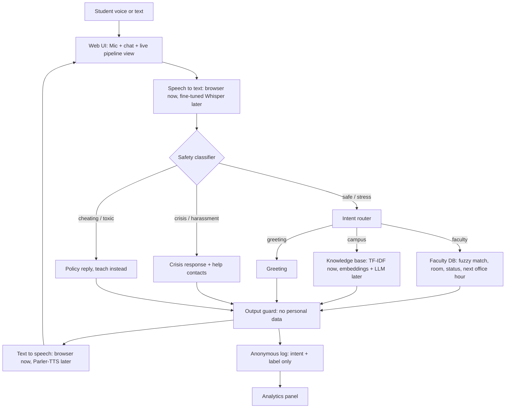

# Architecture

## Phase 1 (this repo, working today)
Rule-based safety, TF-IDF retrieval, CSV faculty DB, browser STT/TTS.
## Phase 2 (upgrade path, matches the thesis plan)
| Component | Now | Upgrade |
|---|---|---|
| STT | Browser Web Speech API | Whisper fine-tuned on Bangla/Banglish |
| TTS | Browser speechSynthesis | Indic Parler-TTS (pretrained, no fine-tune) |
| Safety | Regex rules (EN/Bangla/Banglish) | Fine-tuned DistilBERT, report precision/recall |
| Retrieval | TF-IDF | Sentence embeddings + ChromaDB |
| Answering | Template | Llama 3 / Qwen + small LoRA, grounded on retrieved text |
## Safety rules
Crisis/harassment never reach the LLM; answers only from verified data; unknown means "I'm not sure";
no phone numbers or addresses; no raw voice or text stored.
